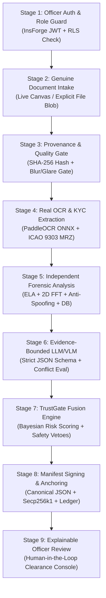

# TRUSTGATE AI — NEXT-VERSION SYSTEM ARCHITECTURE SPECIFICATION
**Document ID:** `TG-DOC-ARCH-002`  
**System:** TRUSTGATE AI BILLION (Border & Identity Document Screening Platform)  
**Engineering Standard:** Google Production Engineering / MIT Systems Architecture / Harvard Analytical Rigor / Stanford AI Research Standards  
**Version:** 3.0.0-NextGen  
**Status:** PRODUCTION ARCHITECTURE SPECIFIED & IMPLEMENTED  

---

## 1. Architectural Philosophy & Non-Negotiable Invariants

TrustGate AI is engineered around the principle of **strict cryptographic evidence binding and verifiable provenance**. An identity screening decision cannot be considered valid unless every step of inference is provably tied to the exact pixel buffer submitted by the authorized officer.

### The Five Core System Invariants

1. **The Quad-Binding Invariant**:
   Every pipeline execution is uniquely and immutably indexed by an authentic 4-tuple:
   $$\mathcal{B} = \langle \text{case\_id}, \text{document\_id}, \text{processing\_run\_id}, \text{image\_hash} \rangle$$
   Where:
   - $\text{case\_id} \in \text{UUIDv4}$ (Container for multi-document passenger clearance).
   - $\text{document\_id} \in \text{UUIDv4}$ (Unique entity for the specific passport/visa card).
   - $\text{processing\_run\_id} \in \text{UUIDv4}$ (Monotonically unique execution run; retries generate a new run ID).
   - $\text{image\_hash} \in \{0,1\}^{256}$ (Cryptographic SHA-256 digest computed over the raw pixel buffer).

2. **The Zero-Synthetic-Fallback Invariant**:
   Under no circumstances may the intake or processing pipeline inject, default to, or mock reference/demo credentials. If a video frame capture or file read fails, the system immediately halts with a terminal error state (`ACQUISITION_FAILED`).

3. **The Evidence-Bound Reasoning Invariant**:
   Language and vision-language models (LLMs/VLMs) serve strictly as structured synthesizers of verified evidence. An LLM may never invent missing fields, synthesize biometric matches, or overturn hard algorithmic or cryptographic failures (e.g., ICAO 9303 checksum failures or tamper flags).

4. **The Three-Valued Database Invariant**:
   Absence of a record in an immigration watchlist does not constitute evidence of fraud. Database checks adhere to formal three-valued logic:
   $$\text{DB\_State} \in \{\text{VERIFIED\_CLEAR}, \text{SANCTIONS\_WATCHLIST\_HIT}, \text{NO\_RECORD\_FOUND}\}$$

5. **The Off-Chain PII Invariant**:
   Public or permissioned distributed ledgers are utilized exclusively for immutable cryptographic anchoring. No Personally Identifiable Information (PII), raw biometric templates, portrait photographs, or cleartext credentials are ever transmitted to or stored on a blockchain.

---

## 2. The 9-Stage End-to-End Screening Pipeline



### Stage 1: Officer Authentication and Authorization
- **Mechanism**: InsForge JWT session validation with database-backed `profiles` table lookup.
- **Role Hierarchy**: 
  - `officer`: Screening intake, inspection review, manual disposition.
  - `supervisor`: Second-level review, clearance overrides, incident disposition.
  - `admin`: User provisioning, audit trail review, policy configuration.
  - `analyst`: Read-only forensic telemetry, reporting, and model audit.
- **Fail-Safe**: If `auth.uid() IS NULL`, the session is classified as `'anon'` and denied all document and screening mutation permissions.

### Stage 2: Genuine Document Intake
- **Mechanism**: Dedicated HTML5 `<video>` / `<canvas>` capture or explicit user file upload via `<input type="file" accept="image/*">`.
- **Integrity Check**:
  - Validates MIME type (`image/jpeg`, `image/png`, `image/webp`).
  - Verifies minimum dimensions ($800 \times 600$ pixels) and maximum file size (15 MB).
  - Explicitly eliminates legacy sample fallbacks.

### Stage 3: Provenance, Cryptographic Hashing, and Quality Gate
- **Mechanism**:
  - Raw pixel array converted to `ArrayBuffer` and hashed via Web Crypto API `SHA-256`.
  - Non-destructive image canvas snapshot preserved in memory.
  - Fast Laplacian variance check for optical blur ($\sigma^2_{\text{Laplacian}} \ge 100.0$).
  - Specular glare histogram analysis ($< 15\%$ saturated pixels in high-luminance bin).
  - Four-corner perspective and boundary framing estimation.

### Stage 4: OCR, Structured KYC Extraction, and MRZ Validation
- **Engine**: Official PaddleOCR PP-OCRv4 ONNX model running in local Python microservice (AVX2 accelerated) with client-side Tesseract.js fallback for offline/isolated edge nodes.
- **ICAO 9303 Doc Parser**:
  - Deterministic parsing of TD1, TD2, and TD3 Machine Readable Travel Documents.
  - 7-3-1 modulo-10 weighting algorithm applied to Document Number, Date of Birth, Expiration Date, and Composite Checksum.
  - Exact checksum mismatch detection with field-level attribution.

### Stage 5: Independent Verification Stages
- **Document Forensics (Tri-Modal)**:
  1. *Error Level Analysis (ELA)*: Measures recompression residual gradient across 95% JPEG quantisation tables.
  2. *2D FFT Spectral Residual*: Detects splicing seam periodicities and high-frequency digital tampering.
  3. *Local Noise Variance*: Laplacian standard deviation consistency across text, background, and portrait regions.
- **Presentation Attack Detection (PAD)**:
  1. *1D FFT Directional Moiré*: Captures high-frequency harmonics characteristic of LCD/OLED screen capture ($> 5.5\times$ harmonic peak ratio).
  2. *Facial Pore Smoothness Entropy*: Identifies synthetic AI-generated diffusion artifacts ($< 2.0$ variance flag).
- **Biometric Matching**:
  - Reference-based cosine distance matching between document portrait and live reference face.
  - If no live reference face is supplied, status is marked as `NOT_AVAILABLE` with `similarity: undefined`.
- **Database Watchlist**:
  - Live query against PostgreSQL `database_identities` table using parameterized queries.
  - Evaluates Interpol Red Notices, national sanctions, and stolen passport registries.

### Stage 6: Evidence-Bounded LLM/VLM Reasoning
- **Engine**: OpenRouter / InsForge AI Gateway running `google/gemini-2.0-flash` or `anthropic/claude-3.5-sonnet`.
- **Input Contract**: Structured JSON containing only verified stage outputs (OCR tokens, MRZ status, ELA residuals, DB status).
- **Output Contract**: Validated JSON schema containing:
  - `summary`: Concise executive summary of forensic findings.
  - `conflicts`: Explicit list of cross-modal inconsistencies (e.g., visual name $\ne$ MRZ name).
  - `confidence_assessment`: Qualitative reliability score.
  - `recommended_action`: `ALLOW`, `MANUAL_REVIEW`, or `REJECT`.
- **Hard Rule**: LLM output is strictly advisory; it cannot suppress a hard fail from Stage 4 or Stage 5.

### Stage 7: TrustGate Fusion Engine
- **Mechanism**: Bayesian multi-factor risk engine that aggregates weighted anomalies across all dimensions:
  $$\text{RiskScore} = \sum_{i=1}^{n} w_i \cdot \text{Anomaly}_i$$
- **Separation of Metrics**: Risk score ($[0, 100]$) is maintained completely distinct from Model Confidence ($[0, 1.0]$).
- **Deterministic Veto Rules**:
  - ICAO 9303 checksum failure $\implies$ Automatic `REJECT` (Risk = 100).
  - Sanctions / Interpol watchlist hit $\implies$ Automatic `REJECT` (Risk = 100).
  - Splicing / ELA tamper severity $> 92\text{ dB}$ $\implies$ Automatic `REJECT` (Risk $\ge 90$).
  - Optical blur / glare failure $\implies$ Automatic `MANUAL_REVIEW` (Risk = 50).

### Stage 8: Evidence Manifest & Cryptographic Audit Anchoring
- **Manifest Generation**: Canonical deterministic JSON encoding of the complete screening session, including stage timestamps, algorithm versions, raw scores, and officer badge ID.
- **Digital Signature**: SHA-256 manifest digest signed using ECDSA secp256k1.
- **Persistence**: Saved to `evidence_manifests` table in InsForge PostgreSQL.
- **Optional Blockchain Anchoring**: Hash anchored to EVM or Layer-2 audit ledger (`blockchain_audit_anchors`), logging transaction hash and block confirmation.

### Stage 9: Explainable Officer Review & Human-in-the-Loop Clearance
- **Interface**: High-contrast, WCAG 2.1 AA compliant officer console displaying:
  - Original document side-by-side with localized tampering heatmaps.
  - Field-by-field OCR verification with character-level confidence.
  - Step-by-step risk factor contribution tree.
  - One-click override with mandatory supervisory reason logging.

---

## 3. Database Schema & Row-Level Security Architecture

The database architecture runs on PostgreSQL 15.18 on InsForge (`i8yy29ec.us-east.insforge.app`).

```
+----------------------------------------------------------------------------------------------------+
|                                    POSTGRESQL DATABASE SCHEMA (8 TABLES)                           |
+----------------------------------------------------------------------------------------------------+
|  1. cases                    : Case container, status, assigned officer, created_at                |
|  2. documents                : Document metadata, storage URL, original SHA-256 hash                |
|  3. screening_runs           : Unique run execution, pipeline version, latency telemetry           |
|  4. screening_results        : Structured OCR, MRZ, tampering, biometric, and fusion outputs       |
|  5. evidence_manifests       : Canonical serialized JSON manifest, SHA-256 digest, digital signature|
|  6. blockchain_audit_anchors : Network ID, contract address, transaction hash, block height, status |
|  7. profiles                 : Officer badge ID, full name, border station, assigned role           |
|  8. audit_events             : Append-only immutable log of every access, clearance, or override   |
+----------------------------------------------------------------------------------------------------+
```

### Row-Level Security (RLS) Policies
- All tables enforce `ALTER TABLE ... ENABLE ROW LEVEL SECURITY;`.
- **Read Access**: Authenticated officers and supervisors may view records within their jurisdiction.
- **Write Access**: Restricted to authenticated officers initiating a run or supervisors recording an override.
- **Immutability Enforcement**: `blockchain_audit_anchors`, `evidence_manifests`, and `audit_events` strictly forbid `UPDATE` and `DELETE` operations via database policies and triggers.

---

## 4. Production Deployment Topology

- **Edge Frontend**: Vercel Edge Global CDN (`https://i8yy29ec.insforge.site`).
- **HTTP Headers**:
  - `Content-Security-Policy`: Restricts script and connection origins strictly to `self`, `i8yy29ec.us-east.insforge.app`, and authorized font/CDN assets.
  - `X-Content-Type-Options: nosniff`
  - `X-Frame-Options: DENY`
  - `Referrer-Policy: strict-origin-when-cross-origin`
- **Backend API**: InsForge Managed BaaS (PostgREST + Realtime WebSockets).
- **Forensic Compute**: Local Python 3.14 AVX2 microservice on border terminal.
